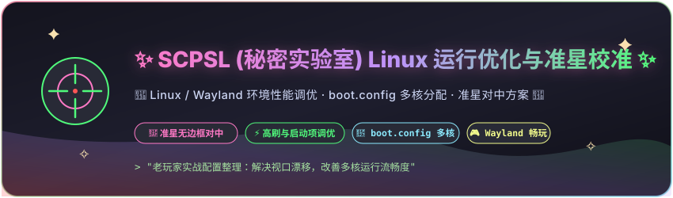

<div align="center">

  

  <br><br>

  <p align="center">
    
    
    
    
    
  </p>

  <p align="center">
    <i>面向 Arch Linux / Wayland 环境下的 SCP: Secret Laboratory 性能优化与准星校准方案（老玩家实践整理）</i>
  </p>

</div>

---

## 💻 硬件测试环境与参考配置 (Hardware Specs & Test Environment)

为便于评估方案的适用性与复现条件，下表列出了本文档所基于的**测试验证环境**与建议的**最低运行基准**：

| 项目 | 测试验证参考规格 (Tested Environment) | 最低运行参考门槛 (Minimum Requirements) |
| :--- | :--- | :--- |
| **操作系统** | Nyarch Linux x86_64 (Linux Kernel 7.x, Wayland / Niri) | Arch Linux 及常见 Linux 64 位发行版 |
| **处理器 (CPU)** | 13th Gen Intel Core i7-13620H (16 线程) | 4 核心 8 线程以上 64 位处理器 |
| **显卡 (GPU)** | NVIDIA GeForce RTX 5060 Laptop (驱动版本: 615.78+) | 支持 Vulkan 1.3 的独立显卡或现代核显 |
| **屏幕规格** | 1080p @ 144Hz IPS 高刷新率屏 | 1080p @ 60Hz 标准显示设备 |
| **运行内存** | 16 GB DDR5 | 8 GB RAM |

> 📌 *说明：文中涉及的参数调优与启动项设置均在上述实测机型中验证稳定。不同硬件规格与驱动版本可能存在细微差异，建议结合个人设备实际情况配置。*

---

## 🎯 一、准星偏移与指针脱节排查 (Crosshair Offset Fix)

在 Linux（特别是 Wayland 会话与平铺式窗口管理器）环境下运行 SCPSL 时，常见问题之一是准星与物理鼠标光标脱节，导致射击落点偏移。

### 原理解析：
Unity 引擎在独占全屏 (Exclusive Fullscreen) 模式下调用系统指针限制 (Pointer Constraint / Cursor Lock) 时，容易与桌面环境的视口分辨率缩放产生坐标映射偏差。

### 解决方案：
进入游戏「设置 (Settings)」 -> 「视频 (Video)」：
- **显示模式 (Display Mode)**：选择 **【无边框窗口化 (Borderless Windowed)】**；
- 配合 Wayland / Niri 窗口居中规则，即可恢复准星物理对中与正常的鼠标输入手感。

---

## 📂 二、boot.config 文件定位与修改 (File Location)

在 Steam 客户端中定位该配置文件的方法：

1. 打开 Steam 客户端，在左侧游戏库中找到 **《SCP: Secret Laboratory》**；
2. 右键点击游戏 -> **「管理 (Manage)」** -> **「浏览本地文件 (Browse local files)」**；
3. 进入 **`SCPSL_Data`** 目录；
4. 找到名为 **`boot.config`** 的文件，使用任意文本编辑器打开。

---

## ⚡ 三、boot.config 多核与渲染参数调优 (Optimization Parameters)

将 `SCPSL_Data/boot.config` 修改为以下参数配置：

```ini
gfx-enable-native-gfx-jobs=1
gfx-enable-gfx-jobs=1
gfx-disable-mt-rendering=1
job-worker-count=6
hdr-display-enabled=0
gc-max-time-slice=1
no-stereo-rendering=1
force-feature-level-9-3=1
wait-for-managed-debugger=0
wait-for-native-debugger=0
scripting-runtime-version=latest
vr-enabled=0
```

### 核心参数说明：
- **`job-worker-count=6`**：
  设置引擎工作线程数量。请根据个人 CPU 的物理大核与线程数调整（如 8 核处理器可设为 6~8），使多核充分分担任务，改善主线程拥堵导致的偶发卡顿；
- **`gfx-enable-native-gfx-jobs=1` & `gfx-enable-gfx-jobs=1`**：
  启用引擎底层原生图形任务多线程调度，平衡渲染管线压力；
- **`gc-max-time-slice=1`**：
  将 Unity 垃圾回收单次切片时间上限限制在 1ms，减轻团战与场景加载时的瞬时掉帧；
- **`hdr-display-enabled=0` & `vr-enabled=0`**：
  关闭未使用的 HDR 与 VR 监测，减少不必要的图形管线开销；
- **`wait-for-managed-debugger=0`**：
  禁用调试器检测等待，缩短游戏加载时间。

---

## 🚀 四、Steam 推荐启动选项 (Steam Launch Options)

在 Steam 库中右键游戏 -> **「属性」** -> **「常规」** -> **「启动选项」** 中填入：

```bash
-quality 0 accuracystats -gfx-disable-vsync -disable-assembly-update-check -screen-fullscreen 0 -targetFrameRate 320
```

### 参数释义：
- `-targetFrameRate 320`：放开引擎默认帧率限制（高刷屏可按需设为 144、240 或 320）；
- `-screen-fullscreen 0`：启动时强制采用窗口化模式，避免全屏指针错位；
- `-gfx-disable-vsync`：禁用垂直同步，降低输入延迟；
- `-disable-assembly-update-check`：跳过程序集热更新检查，提升进入速度；
- `accuracystats`：启用命中统计与网络同步信息显示。

---

## 🌐 五、默认语言切换为简体中文 (Language Setup)

新安装的游戏默认语言为英文，切换步骤如下：

1. 启动游戏进入主界面；
2. 点击右上角设置齿轮图标 **(Settings)**；
3. 切换至 **「Language」** 选项卡；
4. 下拉菜单中选择 **「简体中文 (Simplified Chinese)」** 并确认保存。

---

## 🛠️ 六、自动化配置脚本与回滚机制 (Script & Rollback)

仓库内提供了辅助脚本，支持自动探测游戏路径与备份写入：

```bash
# 克隆仓库
git clone https://github.com/shenchuchu91-hub/SCPSL-ArchLinux-Optimization.git ~/scpsl-opt

# 执行配置脚本
cd ~/scpsl-opt
chmod +x scripts/scpsl-optimizer.sh
./scripts/scpsl-optimizer.sh
```

### 🛡️ 安全与回滚说明：
- **自动备份**：脚本执行时会自动将原配置文件备份为 `SCPSL_Data/boot.config.backup_时间戳`；
- **手动回滚**：如需恢复原有状态，将备份文件重命名还原回 `boot.config` 即可；
- **合规声明**：本项目所有配置均为 Unity 官方支持的常规引擎参数与显示调度调整，不涉及任何外挂注入、内存修改或破坏游戏公平性的行为，符合游戏发行方 EULA。完整条款请见 [全局免责声明与安全守则 (Disclaimer)](https://github.com/shenchuchu91-hub/disclaimer)。

---

<div align="center">

🌸 **版权与许可** 🌸  
本项目基于 [MIT License](LICENSE) 开源发布。

<sub>Made with 💖 by <b>shenchuchu91-hub</b></sub>

</div>
